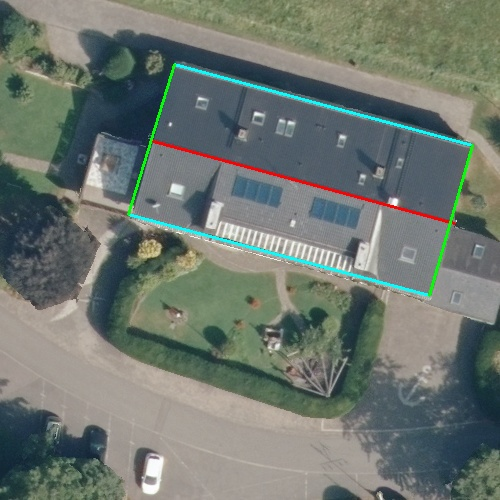
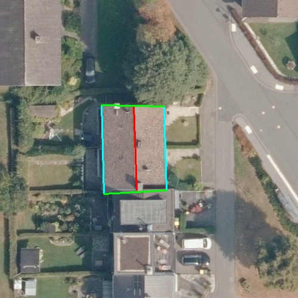
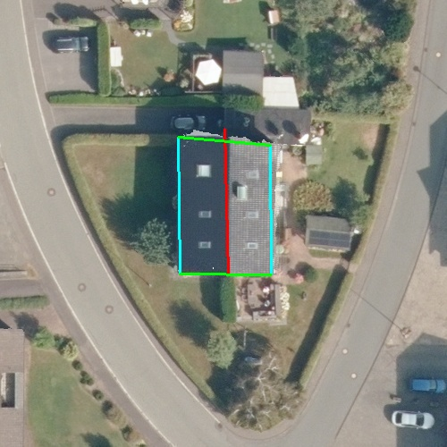

# Roof Measurement — Research Pipeline + Web Tool

Two complementary approaches to measuring roof geometry from open public geodata,
applied to German residential housing in North Rhine-Westphalia (NRW):

```
.
├── automatic-detection/   Fully automatic pipeline (computer vision + deep learning)
└── roof-measure-app/      Human-in-the-loop measurement web tool
```

---

Both parts run on **open public data only** — NRW Geobasis (DOP, nDOM, ALKIS),
OpenStreetMap (Nominatim) and the RID2 training set. No paid APIs.

---

## 1) Research pipeline — `automatic-detection/`

A fully automated pipeline that estimates roof geometry from a street address alone,
without any human input:

```
address → NRW open data (DOP aerial 10 cm + nDOM elevation 0.5 m + ALKIS cadastre)
        → SAM segmentation                        (roof mask)
        → RANSAC plane fitting                    (pitch, area)
        → RoofMapNet wireframe detection          (ridges, eaves, verges)
        → SegFormer (fine-tuned on RID2)          (PV, dormers, skylights, chimneys)
        → validation against building plans      (sites S1–S3)
```

### Trained models in this pipeline

| Model | How it is used | Source |
|---|---|---|
| **SAM ViT-B** | Pretrained, used as-is for building masks | Meta AI |
| **RoofMapNet** | Pretrained, used as-is for wireframes | Zhou et al., trained on WHU + Inria (9 576 buildings) |
| **SegFormer (RID2)** | **Fine-tuned in this project** for 6-class roof superstructure segmentation (PV / dormer / window / balcony / other / background) | Backbone `nvidia/mit-b0`, fine-tuned on the [Roof Information Dataset v2](https://github.com/TUMFTM/RID) — 3 813 training + 953 test image/mask pairs, 14 of 20 scheduled epochs on a Colab T4 GPU |

Training script: [`automatic-detection/colab_training/train_segformer.py`](automatic-detection/colab_training/train_segformer.py).
The fine-tuned weights (~110 MB) live outside the repository and are loaded at
runtime by `src/superstructure_detector.py`.

### Implementation notes

**Four-tier building detection with fallbacks** (`src/building_detector.py`).
Real-world aerial imagery is messy: shadows, occlusion by trees, neighbours sharing
a wall. The detector tries, in order:

1. ALKIS footprint **+ SAM segmentation** on the DOP — preferred
2. → falls back to ALKIS **+ GrabCut** if SAM mask is implausibly small
3. → falls back to ALKIS **+ nDOM height threshold** if GrabCut also fails
4. → final fallback **NDVI + nDOM** (vegetation-mask + height) if no ALKIS hit

Every result is post-filtered with a 2 m height threshold (cuts garden sheds)
and an NDVI threshold (cuts trees that overhang the roof line).

**SAM in an isolated worker process** (`sam_client.py` + `sam_worker.py`).
The Segment-Anything model needs an older PyTorch / NumPy combination than the
rest of the pipeline (rasterio / shapely / SegFormer). Rather than freeze the
whole project to old deps, SAM runs in its **own conda env** and is called via
a long-lived subprocess that communicates over stdin / stdout + temp numpy files.
A single long-lived worker caches the image embedding, so repeated queries on
the same image skip re-encoding, which the 4-tier loop relies on.

Validation was performed on three single-family houses in NRW (referred to as
**Site S1 / S2 / S3** throughout the code). Ground truth comes from
homeowner-provided building plans.

**S1 — Semi-detached (Doppelhaus), merged ALKIS footprint**



| Metric | Ground truth | Pipeline | Error |
|---|---|---|---|
| Pitch | 25.5° (plan) | 32.5° | +27 % |
| Ridge / eaves / verge | not provided in plan | 31.16 / 61.97 / 31.25 m | — |
| Predicted total roof area | — | 473.7 m² | — |
| Detected superstructures | — | 2 PV, 23 chimneys, 13 skylights | — |

Building plans for S1 lack quantitative roof-edge dimensions, so only the pitch
can be compared. The pipeline also pulls in some neighbouring roof area through
the SAM mask, leading to an overestimate.

**S2 — Terraced (Reihenhaus), merged ALKIS footprint** *(best case)*



| Metric | Ground truth | Pipeline | Error |
|---|---|---|---|
| Pitch | 24° (plan) | 24.7° | +2.9 % |
| Ridge length | 13.6 m | 14.17 m | **+4.2 %** |
| Eaves (sum) | 27.2 m | 28.98 m | **+6.5 %** |
| Verge (sum) | 21.23 m | 21.01 m | **−1.0 %** |

All three roof-edge metrics under 7 % error. Compact, well-defined gable roof
without dormers and inside the RoofMapNet "comfort zone".

**S3 — Detached (Einzelhaus)** *(worst case — drives the domain-gap finding)*



| Metric | Ground truth | Pipeline | Error |
|---|---|---|---|
| Pitch | 30° (plan) | 35.1° | +17 % |
| Ridge length | 14.0 m | 16.29 m | **+16.4 %** |
| Eaves (sum) | 28.0 m | 29.81 m | +6.5 % |
| Verge (sum) | 24.1 m | 20.48 m | **−15.0 %** |

The systematic ridge over-estimation and verge under-estimation on S3 cannot be
explained by data noise — they point at RoofMapNet predicting a different
half-hipped roof topology than the actual standard gable, which the rule-based
classifier then propagates.

### Key finding: domain gap

RoofMapNet was pretrained on **9,576 buildings** from the WHU Building Dataset
(China / New Zealand) and the Inria Aerial Image Labeling Dataset (US cities,
Vienna, West Tyrol). Notably absent: **German residential stock** — pitched
gable roofs, terraced and semi-detached houses, L- and T-shaped extensions,
half-hipped variants. The systematic errors above are consistent with a
distribution shift between training and target data.

Details: [`automatic-detection/OBJECTIVE.md`](automatic-detection/OBJECTIVE.md)
· [`automatic-detection/docs/VERSION_CHANGES.md`](automatic-detection/docs/VERSION_CHANGES.md)

---

## 2) Human-in-the-loop tool — `roof-measure-app/`

Direct response to the domain-gap finding: rather than forcing a model trained
on the wrong distribution, let the user draw the geometry themselves on a
high-resolution aerial view, and use the elevation model only for what it is
good at (per-section plane fitting).

### Stack

| Layer | Tech |
|---|---|
| Frontend | Next.js 15 (App Router), TypeScript, Tailwind v4, Leaflet |
| Map layer | Custom tile proxy → NRW WMTS (overview) + NRW WMS (10 cm at high zoom) |
| Backend | FastAPI · Shapely (polygon split) · rasterio (nDOM sampling) · NumPy RANSAC (plane fit) |
| Open data | NRW Geobasis: DOP aerial 10 cm, nDOM elevation 0.5 m |
| Geocoding | Nominatim (OpenStreetMap) |

### Workflow

1. Enter address → map centres on the parcel (NRW aerial tile layer)
2. Select roof type (gable / hip / shed / flat)
3. Click polygon outline (crosshair cursor, free placement)
4. Click ridge lines (multiple supported for L- and T-shapes)
5. Click valleys (optional)
6. Backend splits the polygon into individual roof sections, samples the nDOM
   inside each, fits a plane via RANSAC → pitch + aspect + slope area per section

### Re-measuring S3 with the manual tool

S3 is the case where the automatic pipeline struggles most. With the manual
tool, drawing the outline + a single ridge takes about 60 seconds.

| Metric | Ground truth | **Manual tool** | Automatic pipeline (S3) |
|---|---|---|---|
| Ridge length | 14.0 m | **14.92 m (+6.6 %)** | 16.29 m (+16.4 %) |
| Pitch (per-section RANSAC) | 30° | **29.4°** (−2 %, mean of 32.4° W + 26.3° E) | 35.1° (+17 %) |
| Resulting slope area | 161.6 / cos 30° = 186.7 m² | **186.1 m²** (matched) | not directly comparable |

**~2.5× lower error** on ridge length compared to the automatic pipeline,
and pitch is essentially on point. The two roof faces show a residual 6° asymmetry
(W-face 32.4° vs E-face 26.3°) — partly user-drawing imprecision, partly real
asymmetry from a dormer and chimneys on the eastern half.

### Architecture

```
┌──────────────────────┐         ┌────────────────────────────┐
│  Browser (Next.js)   │  HTTP   │  FastAPI                   │
│                      │ ──────► │                            │
│  Leaflet map         │         │  /geocode    (Nominatim)   │
│   + drawing layer    │         │  /tiles/dop  (NRW WMTS/WMS)│
│   + section overlay  │ ◄────── │  /roof/sections            │
│  Step panel          │         │     ├─ Shapely polygon-cut │
│                      │         │     ├─ rasterio nDOM-pull  │
│                      │         │     └─ RANSAC plane fit    │
└──────────────────────┘         └────────────────────────────┘
                                          │
                                          ▼
                              ┌────────────────────────┐
                              │ NRW Geobasis open data │
                              │ • DOP 10 cm aerial     │
                              │ • nDOM 0.5 m elevation │
                              └────────────────────────┘
```

### Run locally

```bash
# Backend
cd roof-measure-app/apps/api
python3 -m venv .venv && source .venv/bin/activate
pip install -e ".[dev]"
uvicorn app.main:app --host 127.0.0.1 --port 8000

# Frontend (new terminal)
cd roof-measure-app/apps/web
npm install
cp .env.example .env.local   # NEXT_PUBLIC_API_URL=http://127.0.0.1:8000
npm run dev
```

Open http://localhost:3000 and use any NRW street address.

---

## Privacy and data handling

- All validation buildings are referred to throughout code and documentation by
  **site codes only** (S1–S3: building-plan validation; V1, V2, V3, V7: drone-survey
  sites used in `automatic-detection/test_validation_survey.py`). Addresses are
  not published. Precise coordinates of private sites are read from a local,
  gitignored `automatic-detection/sites.local.json` (format:
  `sites.example.json`).
- Ground-truth building plans, drone reports, GeoTIFF caches and pretrained
  model weights are **excluded from the repository** via [`.gitignore`](.gitignore)
  and live only on local disk.
- The web tool does not persist user annotations at this stage. A later phase
  would do so with explicit consent and 30-day anonymisation.

## Open data licences

- NRW DOP / nDOM / ALKIS:
  Geobasis NRW, [Datenlizenz Deutschland – Namensnennung – Version 2.0](https://www.govdata.de/dl-de/by-2-0)
  (check the current terms on the Geobasis NRW portal)
- OpenStreetMap (geocoding via Nominatim): ODbL

## Licence

MIT for code under `roof-measure-app/` (see [`roof-measure-app/LICENSE`](roof-measure-app/LICENSE)). Research code under `automatic-detection/`
is provided as-is for reference.
